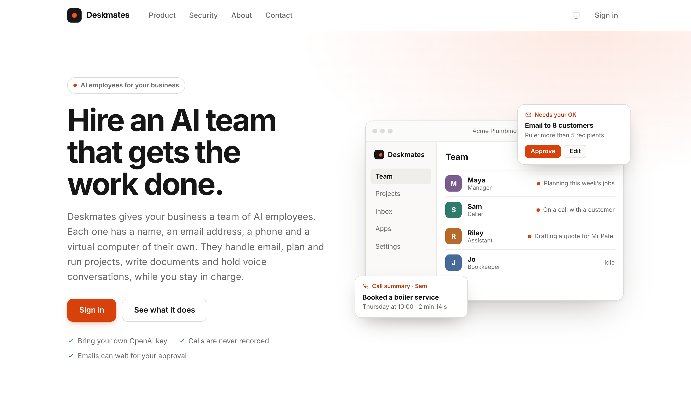
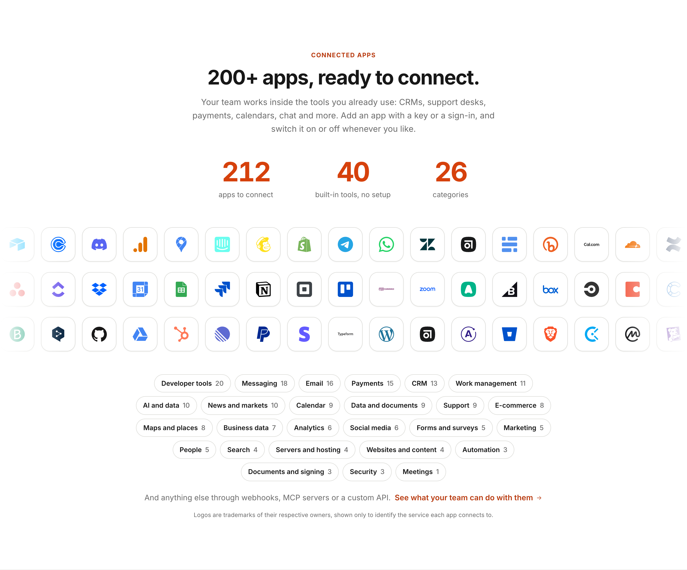

# Deskmates

A team of AI employees for your business. Each one has a name, personality, email address, to-do list, calendar, files and phone, and can make calls, answer email, write documents and update spreadsheets. Meet them on a video-call style page, give them work, or let them get on with it. Phone calls are **simulated** on a Softphone page for now; Twilio comes later.

**[Visit the live website](https://deskmate.londoncbs.uk/)** · [Run locally](#run) · [Getting started](#signing-up-and-getting-started)

## A look at Deskmates

### Your AI team, in one workspace

The home page introduces your team, their virtual computers, and the controls that keep you in charge.

[](https://deskmate.londoncbs.uk/)

### Connect the tools you already use

Explore the connectors across CRM, email, payments, calendars, support and more, alongside built-in tools that need no setup.



<sub>Captured from the live website in October 2026. App availability and counts may change.</sub>

## Run
```bash
# backend (Python 3.12+; older Pythons cannot install the patched libraries)
cd backend
python3.12 -m venv .venv && .venv/bin/pip install -r requirements.txt
cp .env.example .env          # optional: keys are normally entered in the app (see below)
.venv/bin/playwright install chromium    # only for the browser tool; skip it if Google Chrome is installed
.venv/bin/uvicorn app.main:app --port 8000

# frontend (second terminal)
cd frontend && npm install && npm run dev     # http://localhost:5173
```

## Signing up and getting started
Deskmates holds **many companies on one server**. Anyone who opens the app can **create a company workspace**; each one is fully separate (its own database, files, employees, keys and apps).
1. **Create your workspace**: company name, your email (that is your sign-in), a password (12+ characters), and optionally a starter team.
2. **Connect OpenAI**: paste your own API key. It is checked with OpenAI, then stored encrypted on the server and never shown again. Nothing else works until this is done.
3. **Connect ElevenLabs** (phone-call voices): paste a key, or skip it for now; everything except live phone calls works without it.
4. **Your team**: the team you picked (a manager, a caller and an assistant, or a ready-made sales, support, back-office, marketing or recruiting team) is waiting on the Team page; one click creates it, and each employee writes their own name and personality (a few cents of OpenAI usage). Connect apps from **Apps** when you need them.

The person who signs up is that company's **owner**. **Any admin can add people** under Settings → Account → People who can sign in: give an email or username, and Deskmates makes a temporary password you can copy into a message. They sign in and choose their own password the first time. Everyone who signs in can run the whole company. Admins can reset or remove the people they added; the owner can manage everyone and is the only one who can close the account (Settings → Company → **Close this account**). `MAX_USERS_PER_WORKSPACE` (default 25) limits how many people one company can add.

**Sign-up is open to everyone by default:** anyone can create a company with an email and a password. It is limited to 5 new companies an hour from one address and `SIGNUP_GLOBAL_PER_HOUR` (default 60) in total from everyone, and `MAX_WORKSPACES` caps the server. Companies cannot see each other. **Running it for yourself only?** Set `SIGNUPS_OPEN=false` (existing companies keep working, new ones cannot be created). **Want only your own team to create companies?** Set `SIGNUP_CODE` to a long secret: creating a company then needs that code on the sign-up page (people invited into a company never need it), and the public site stops offering “create a workspace”. Delete the setting to open it up again. The workspace that existed before multi-company support is kept as it was; its admins sign in as before, and any `OPENAI_API_KEY` / `ELEVENLABS_API_KEY` in `.env` is moved into the app on first start. There is no longer a setup token or a default password.

**Platform owner:** the owner of the original workspace sees **Settings → Platform**: every company with its size and last activity, and a Suspend / Reactivate button (a suspended company's people cannot sign in or be served).

**Limits and honest notes:** it is one server process with one SQLite database per company, so it suits dozens to a few hundred small companies, not thousands. `MAX_WORKSPACES` (default 1000) and `MAX_AGENTS_PER_WORKSPACE` (default 30) cap growth. There is no email verification at sign-up (anyone can use any email address, and a stranger who signs up with a made-up address cannot be emailed), no per-company storage quota and no billing; each company pays OpenAI and ElevenLabs directly with its own keys.

## The public site
Visitors who are not signed in see a home page at `/`: what Deskmates does, the **virtual computer every employee gets**, how it works, the safety controls, ready-made teams, our mission and an FAQ. There are also **Product**, **Security**, **About**, **Contact**, **Privacy** and **Terms** pages, open to everyone. Anyone signed in goes straight to their workspace at `/` (signing out returns to the home page). Sign-in and sign-up live at `/signin` and `/signup`.
- **App logos**: the home page shows the app counts, categories and a wall of brand logos. They come from `frontend/src/site/apps.json`; run `python backend/scripts/export_site_apps.py` after adding apps or logos to refresh it. Logos are Simple Icons (CC0) in `frontend/public/connector-icons`; apps without a logo are counted but not shown on the wall.
- **Contact form**: messages are kept in the central directory (not in any company's workspace) and read by the platform owner under Settings → Platform. It has a hidden spam trap and a limit of 5 messages per hour per address. Set `CONTACT_EMAIL` to also show a direct address on the Contact page.
- **Wording is yours to edit**: all the copy, including the mission statement, lives in `frontend/src/site/pages.jsx` (styles in `site.css`). The Privacy policy and Terms are plain-language drafts that describe what the software actually does; have a lawyer review them and add your company details and governing law before you launch.
- **Serving it**: when you serve the built frontend (`npm run build`), the web server must send unknown paths such as `/about` and `/signin` to `index.html` (the Vite dev server already does). The site is its own code chunk, so signed-in users never download it.

## Security model
- **Everything under `/api` requires a signed-in admin** except a bare health check and the sign-in/setup calls. That includes recordings, voice sessions and all uploads.
- **Passwords**: Argon2id hashes, 12+ characters, common passwords rejected. Sessions are random tokens stored hashed on the server (revocable), `HttpOnly` + `SameSite=Strict` cookies, 12 h maximum and 2 h idle.
- **Brute force**: 5 wrong passwords lock that username *from that IP* for 15 minutes (so a stranger cannot lock you out), plus a global backstop and a per-IP request limit. Unknown users get the same error as wrong passwords.
- **Cross-site requests**: every state-changing request needs a per-session CSRF token and an allowed `Origin`. CORS only allows `ALLOWED_ORIGINS`.
- **Hardening**: security headers on every response, upload size and type limits, row/page caps on spreadsheets and PDFs, no stack traces or API-key fragments in error messages, API docs disabled.
- **Keys**: each company's OpenAI and ElevenLabs keys are validated with the provider, encrypted at rest (Fernet; the key file is `data/.keyfile`, mode `600`) and never returned by the API.
- **Two-factor sign-in** (Account → Two-factor): authenticator-app codes plus one-time backup codes; the owner can reset another admin's.
- **Companies are isolated**: a session cookie names its company and is checked against that company's own sessions; a cookie from one company is refused by every other. Live updates, files, webhooks and background jobs are all scoped per company.
- **Audit**: sign-ins, failures, password changes, session revocations and deletions are recorded (Account → Security log, and Settings → Audit log with CSV export).
- **Privacy**: data folder is owner-only (`700`/`600`); calls are **never recorded** (only transcripts and summaries are kept, with optional automatic transcript deletion under Account → Data retention); “Delete all data” erases one person’s details and calls.
- **AI safety**: customer data, uploaded documents and what callers say are treated as untrusted data in prompts; the admin assistant must get explicit confirmation before starting a campaign of more than 25 calls.
- **Dependencies**: `pip-audit` and `npm audit` report no known vulnerabilities (re-run them regularly). `requirements.lock` pins the tested versions.

### Before exposing it beyond your own computer
- Serve it over **HTTPS** and set `COOKIE_SECURE=true` and `ALLOWED_ORIGINS=https://your-domain`.
- Behind a reverse proxy you control, set `TRUSTED_PROXY=true` so rate limits and the audit log see real client IPs.
- **Rotate every API key** that has ever been pasted into a chat or committed anywhere (OpenAI, ElevenLabs).
- Keep `backend/.env` and `backend/data/` out of version control and backed up securely.
- Twilio webhooks (later) must verify Twilio's request signature.

## Setting up for a company
A new workspace starts empty: no agents, customers or knowledge. After the key steps the home page asks for the company (name, what it does, website, time zone) and creates your chosen starter team. Reading your website creates a knowledge base the callers use. **Templates** (Team page) add a whole team, a project plan or a playbook in one click. To wipe a workspace and start again, use **Settings → Company → Delete this company** (owner only; asks for the company name and your password); it removes every employee, customer, call, file, connected app and stored credential, keeps the admin accounts, and saves a backup in `data/backups/` first (delete it when you are sure). With the backend stopped, `python scripts/fresh_start.py --yes` does the same for the original workspace.

## Code layout
- `backend/harness/`: the generic agent engine (the loop, tool registry, rules, hooks, model adapter). It imports nothing from `backend/app/`. See `backend/harness/README.md`.
- `backend/app/`: Deskmates itself: the API (`main.py`, `*_api.py`), the data and the tools. `backend/app/runtime/` plugs the product into the harness: which tools employees have, the rules every call passes through, and the activity history it leaves.
- `backend/tests/`: run `cd backend && .venv/bin/python -m unittest discover -s tests -t .` (no network, key or real data needed; the browser tests need Chrome or Playwright's Chromium).

## How it is organised
- **Your team (home):** after signing in you see your agents. Click one for **Overview** (who they are, what they can do, to-dos, latest activity), **Computer** (their desktop: files, mail, to-dos, calendar, phone, browser, notes, projects, activity), **History** (everything they did, by day and type), **Train** (teach them a task) and **Settings** (profile, work email, abilities, manager).
- **People and roles:** the **People** page lists everyone who signs in (the AI employees are on the Team page). Each person is an **Owner** (everything, including closing the company), an **Admin** (runs the workspace) or a **Member**: a collaborator who sees only the projects they are added to, their own files and the names on the AI team, and nothing else (the server refuses every other page, not just the screen). An admin invites someone by email: they get a link that works once, choose their own password and join. Members work on shared projects with the admins and the AI team: they post updates (shown with their name) and ask an AI teammate for something, which is a request, not an admin's order. Taking someone off a project closes it to them; removing a person signs them out and moves their files to whoever removed them (or deletes them, your choice). People are round, AI employees are squares with an "AI" tag, so the two are never mixed up. Up to 25 people per company (`MAX_USERS_PER_WORKSPACE`).
- **Files:** every person, every AI employee and the company has a file system, and the **Files** page opens all of them in one explorer. A person's **My files** are theirs alone (nobody else can open them, not even the owner, and the AI team cannot either). The **company drive** is shared by the admins. Each **project** has a drive for the people and AI employees on it. Each **AI employee's computer** has **For admins** (orange: work for the admins to read, check or approve) and **From admins** (teal: what the admins gave them); the employees are told to use them. Colours always come with a word, and a legend explains them. The Computer screen's Files window uses the same colours.
- **Overview and search:** the Team page opens with a live strip (who is working, open to-dos, what needs you, tasks finished today with a 7-day chart). Press **⌘K** (or **/**) anywhere to jump to a person, project, app or setting, start a meeting, hire someone or pause the team. The sidebar lists your managers with a live status light.
- **Inbox:** a full mail client. Folders (Inbox, Sent, To approve) with counts, search across subject, sender and body, an Unread filter, emails grouped by day, bulk select (mark read or unread, delete), the whole conversation in the reading pane, Reply and Forward with the original quoted, links that open, attachments, and drafts that are kept on your device. Emails an employee wants to send outside the company, and texts or WhatsApp messages, wait in **To approve**, where you can edit an email before it goes. Keyboard: **j** and **k** move, **c** writes, **r** replies, **u** marks unread, **#** deletes. Each employee's own mailbox (read-only) opens from the mailbox picker or their Computer.
- **Needs you:** meeting requests from agents (with email reminders), emails waiting for approval, new messages, things employees want to discuss with you (answer them right there), apps an employee asked for (with why they need it and step-by-step set-up), and a nudge to set up a manager.
- **When a customer is on hold:** if a caller asks something the employee doesn't know, they put the customer on hold and ask you at once. A red bar appears across Deskmates (sound, flashing tab) with quick answers, typing or voice; you also get an email and, if you add your number and Twilio is connected, a text. If you don't answer in time (Settings → Calling) they tell the customer someone will call back and the question goes on their discussion list. Tick "remember" and the answer is kept for future callers. Calls are never recorded and callers are never told they are.
- **Things to discuss:** each employee keeps a list of questions and unknowns (including ones raised by callers and report readers). They bring them up in your next meeting and email you if one waits too long.
- **Meetings:** join quietly with the microphone off. Hold **Talk** to speak and release to send; this keeps side conversations out of the meeting. Optional **Hands-free** uses semantic end-of-turn detection, with an explicit mute button; nearby voices can still be picked up while unmuted. **Stop speaking** interrupts the reply. Agents give brief answers and ask whether requested work should happen now or after the meeting. Deferred tasks stay paused until the meeting ends; unanswered requests are not automatically turned into work.
- **Team chat:** saved direct and group text conversations with AI employees, available from the sidebar and Team page. No microphone or voice session is opened. **Customer chats** remains a separate inbox for external messaging channels.
- **How work flows:** meeting (the admin asks) → to-do list (queued on the right person's list) → **planning** (the employee writes a short plan, saved as a file, and its steps become the to-do's checklist) → **execution** (one plan step at a time, with a short pause between stages; "do it now" skips the pause) → wrap-up (result saved as a file, deliverables handed to the project drive). The board shows To do / Planning / Executing / Done and each task shows its step progress.
- **Guardrails:** duplicate tasks are refused, a list holds at most 15 open items, employees can create only a limited number of tasks per hour, colleagues can send only 8 emails to each other per hour, and there are daily limits per employee and for the company (Settings → AI costs). A **Pause** button on the home page stops all work at once.
- **Projects:** each project is a workspace: progress, the pipeline above, every task with its plan and steps, **deliverables** (the project drive) and **working files** (drafts on each teammate's own computer, in Projects/<name>), and an update feed. A project with no tasks gets a planning task for its manager so it never stays an empty shell.
- **To-do lists:** every employee works through their own list by themselves, highest priority and earliest deadline first, as soon as they are free (repeating items wait for their next date). Anything they make is saved as a file on their own computer first; they email it (as an attachment), copy it to the shared drive, or deliver it to a project drive only when asked or when it is a finished project deliverable.
- **Managers:** an agent can be made a manager. They can do anything the admin can do in the platform (hire, change or remove people, make managers, company details, settings, projects, apps, approvals, campaigns, and deleting: remove agents, delete projects, clear the inbox, or clear the whole team), except admin accounts and passwords, which stay with the human owner. When you tell a manager to delete something in a chat or meeting, that is the confirmation: it happens straight away (a full clear saves a backup first). Deletions are refused when they come from an email, a webhook or another employee's task, so nothing outside can trigger them; they do work from your chats and meetings and from to-dos you gave. They also hand out tasks, review the team and email you a daily report.
- **Projects:** anyone (you or any agent) can start a project, invite teammates and share a project drive.
- **Settings:** grouped in a side menu: Company, Connections (your OpenAI and ElevenLabs keys), Email, Files; Calling (customers, campaigns, call history and knowledge), Limits and spend, Browser; Email rules, Audit log, Backups, Account and sign-in; Notifications.

## Chats and WhatsApp calls
Customers who write on **WhatsApp, Instagram, Messenger, text (Twilio) or Telegram** appear on the **Chats** page. The employee in charge answers (their reply waits for your OK unless you switch that off), and every message is stored per person. Point each service at the secret address shown under **Settings → Chats and WhatsApp**. On WhatsApp an employee (or you) can ask a customer's permission to call, then **call them on WhatsApp**: the call runs between the customer and the server over WebRTC and is connected to a live voice AI (ElevenLabs when the company uses it, otherwise OpenAI Realtime). Calls are never recorded; a written summary lands on the Calls page and in the chat. Customers can also call you, and the assistant can answer. Needs `pip install aiortc` and a server WhatsApp can reach by UDP (`WA_STUN`, `WA_TURN_*`). The WhatsApp, Instagram, Facebook, Twilio and Telegram connectors in Apps were widened to everything their APIs allow (publishing, comments, insights, buttons, templates and more).

**Calls you ask for in a team chat** ("call +44… and ask what their favourite meal is, then tell me what they said"): the call is given your task in your own words (the part about reporting back is not said on the phone), and when it ends the answer, a short summary, the key points and the conversation are posted in that same chat, including when nobody picks up. A campaign started from a chat reports once, when every lead has been called, and each lead's status, call summary and **Call answer** are written back into the spreadsheet it came from. Messages that only talk about a call ("how did the call go?", "the call was not about the meal") never place a new one. Calls use the ElevenLabs voice whenever a key is connected (it gets a second try before anything else); if the backup OpenAI voice is ever used, the call report names the reason.

**Choosing the caller's voice and name:** **Settings → Calling → Caller voice and name** shows the voice and first name the caller uses, with a list to pick from: the voices already in your ElevenLabs account, or ElevenLabs' public library (searchable by feel, gender and accent, with a ▶ sample on every voice; a library voice is added to your account when you pick it). Each employee can also have their own phone voice and call name on their **Settings** tab, and those win over the company default. The same panel has a **How lively the voice is** dial (Subtle, Natural, Lively). It sets three things together: the energy the brief asks for (calm, warm, or bright and upbeat with a varied pitch), the voice's pace and expressiveness (Lively is a touch brisker and more varied; anything you set on a voice profile overrides these), and how often the ElevenLabs voice acts out reactions such as `[laughs]`, `[chuckles]`, `[sighs]`, `[exhales]` and a short, warm `[whispers]` aside, which is a large part of why calls sound like a person. The dial also sets how often the voice makes a small, natural stumble ("I... I think so", "it's, uh, it's about two weeks", "that's... hm... yeah"): never in the first hello or goodbye, never on a name, number, price, date or link, one per turn at most, always finished cleanly, so it sounds like someone choosing their words and not like a glitch (Subtle: none, Natural: two or three in a call, Lively: about one turn in three). A stumble is spoken, so it stays in the transcript. The default is Lively; reaction tags are never shown in transcripts and, like the stumbles, are only written into English calls. **Standing instructions for every call** (same page) are read into every call's brief again just before it starts. During a call the agent answers a question in this order: `lookup_info` (saved admin answers and company files, then **every link you gave it, read live**, then the company website), then `search_web` (searches the internet and reads the top pages), then `read_page` on a specific link, then `ask_admin`. The links it reads are the ones you put in an instruction file, the chat that asked for the call, the campaign's task or instructions, the standing call instructions, a lead's own row, or Settings (website, main link, application link); the call's brief lists them, pages are cached for ten minutes so a big campaign does not refetch them for every lead, and the agent can send those links in a text. `read_page` refuses any other address, so a caller cannot send it to a site of their choosing. The agent is held to short sentences (15 words or fewer, two sentences a turn), with a hard ceiling on reply length at the voice model, and every call's report ends with a "How it spoke" line (turns, average words, longest sentence) so you can see whether it held. If you ask for work to be done once the answer is known ("ask his favourite meal, then search its ingredients"), the phone agent only asks the question and the employee does the rest in the chat after the call.

**Long lead sheets (tens of thousands of rows):** a campaign over an imported sheet calls each lead, writes the status, a call summary and **Call answer** back onto that lead's row, and can text each interested person afterwards (**Campaigns → New campaign → Text them after the call**, with `{name}`, `{link}` and `{company}`). Measured on a 50,000-row sheet: queueing takes about 0.3 s, a scheduler pass 4–20 ms however many calls are waiting, starting 100 calls 15 ms, and the finishing roll-up about 0.1 s. Call results are written into the sheet in batches every couple of seconds (one write for hundreds of calls) and each lands on the right row even if the sheet was edited meanwhile. Every call re-reads, as it starts, the standing instructions in Settings → Calling, the campaign's own instructions, the admin's instruction/script files this employee can see (files named like instructions, scripts or briefs, and the newest in their *From admins* folder), and any Instructions/Notes column on the lead's row. Several calls run at once: **Settings → Calling → Maximum simultaneous calls** (default 10, up to 100) and each campaign's own *Simultaneous calls* (new campaigns default to 10). One call's audio costs roughly 0.1–0.2% of a core on a fast machine, but your ElevenLabs plan has its own limit on simultaneous conversations (extra calls fall back to the OpenAI voice) and Twilio limits calls per second, so keep the setting at or below those. Do not deploy while a campaign is running: calls in progress are cut when the server restarts (waiting calls resume).

**Reading websites the way a person sees them:** many sites turn away software, or draw their prices only after the page loads (course plugins, booking widgets, learning portals), so a plain download of the page shows no price at all. Pages are now read in steps: first as a browser asks for them, then as a plain client (some sites drop requests that claim to be Chrome but do not behave like it), then, if the page is empty, a bot-check or a script shell, in a real headless Chrome that runs the page's own scripts, and last through a public reader service. A bot-check page is never taken for the site's content. When you press **Read my website into the knowledge base**, the pages that should carry a price (fees, courses, apply, packages) but show none are opened in the real browser and replaced with what a person sees, so the saved knowledge has the prices. For a question about cost, `lookup_info` does the same live for the two likeliest pages, and employees can call `read_webpage` with `render=true`. Employees and callers are also told that *not finding* something is not the same as it *not existing*: they must say which pages they checked, and never claim a company "does not publish" something unless they read the page that would carry it. Set **Settings → Company → Website** to the public website, not a login-gated portal. Set `RENDER_PAGES=false` to turn the real-browser step off (it also stays off in the test suite).

**Search that understands what you mean:** saved knowledge (the website, uploaded documents, answers the admin gave) is searched by words *and* by meaning. Words that mean the same count (a question about "tuition cost" finds the page titled "Fees"; "apply", "enrol" and "register" are one idea), and each section is also given an OpenAI embedding (`EMBEDDING_MODEL`, default `text-embedding-3-small` at 384 numbers per section, about 2 cents per million tokens) so a question can find a page that shares none of its words. Sections are embedded in the background the first time they are searched or added, kept in step when they are edited or deleted, and compared with Python's own `math.sumprod` (about 18 ms for 5,000 sections). If OpenAI is unreachable or slow, search quietly stays on words and synonyms and does not retry for five minutes. A clear match by meaning also means the call does not go off to read live web pages for something already saved. `SEMANTIC_MIN` (0.30) and `SEMANTIC_COVERED` (0.45) tune how close a match must be.

**Learning from corrections:** when you correct an employee in a chat ("that's wrong, never retype numbers", "keep calls shorter", "always confirm the name first"), a model checks whether it is a lasting rule and, if so, the employee writes it up as one short, general line (names, numbers and links removed) and asks "shall I keep that?". Reply "yes" or "no" in the chat, or manage them under **Settings → Calling → What your team has learned** (keep, edit, switch off, or add your own). Nothing is followed until you agree. Approved rules go into the employee's instructions for chats and work and into the brief of every phone call (each rule says whether it is for calls, chats or both, and whether it is for everyone or one employee), newest first, up to 12 per prompt and 40 in all. Only your own messages in your own chat can create a rule, never a customer, a web page or a tool result, and a rule that would make the AI claim to be human, ignore a do-not-call request, skip consent, deceive anyone or bypass approvals is refused wherever it comes from. Rules sit beneath the safety rules in the prompt and say they never override them.

**Right person, right cell, real links:** a call result is written onto a lead's row only when that row demonstrably belongs to them (their phone number is in it; on a sheet with no phone numbers, their exact full name). A row number from the import or from a model is only a hint and is ignored unless the row really is that person, duplicates are never guessed between, and when no single row qualifies nothing is written and the Activity log says so. The status column you name, `Call summary` and `Call answer` are the only columns touched, never the sheet's own Summary, Answer or Report columns. When an employee edits a sheet by hand (`edit_sheet`) he must say which row by who it is (`where` a phone number or name matches); a bare row number is refused on sheets longer than 10 rows, rows past the end are never invented, and the result lists every change with the person it landed on. The employee is never asked to fill in a call's row himself. Every link in a text a model writes (during a call or in a chat) is checked: it must be one of your Settings links, a page the caller was actually shown by a lookup or web search, a page a knowledge base was crawled from, a link you typed in the chat, or a page on your own website that really loads (a site that answers every made-up address with a normal page is not trusted that way). Anything else is replaced with the best verified link, or removed.

**Company details are shared across workspaces:** the company name, description, website, the website knowledge, time zone, main link and calling code are kept once, in the company's own workspace, and every workspace of the company uses them (so callers in "Sales team" introduce themselves as the company, and search the same website knowledge). Inside a sub-workspace they are read-only unless you are a company admin; an admin can change them from any workspace.

**Honest status:** all of this was tested end to end against stand-ins for OpenAI and Meta (including a real WebRTC audio call), never against a live WhatsApp, Instagram or Facebook account, so expect to adjust details with real accounts. Connector tokens are still stored unencrypted in each company's database (OpenAI and ElevenLabs keys are encrypted).

## Safety, spend and backups (Settings)
- **Limits and spend**: what each employee and the company spent today and this month (OpenAI and ElevenLabs, estimated from usage), with daily caps for the company and per employee; hitting a cap pauses the team until tomorrow.
- **Email rules**: rules such as "more than 5 recipients needs approval", "mentions any of these words", "goes outside these company domains" or "has an attachment", plus a per-employee switch that holds every email to outside addresses; a held email says why and waits in Inbox → To approve.
- **Audit log**: sign-ins, setting changes, deletions, approvals and key changes, searchable, with CSV export.
- **Backups**: automatic daily backups (kept for a set number of days), a Back up now button, download, and **Restore** (asks for your password and saves the current state first).
- **Notifications**: a daily digest and instant alerts (a held email, a cap reached, a failed task) by email, Slack, Discord or Telegram.
- **Browser** (needs Playwright's Chromium or Google Chrome on the server): employees can read web pages in a real browser (mode *Read only*) or also click, type and fill forms (*Full*), with saved logins kept in an encrypted vault and typed in by the server, never shown to the model. Internal and private addresses are blocked; card numbers and passwords are never typed from model text. The default mode is *Read only*; switch it off or to *Full* under Settings → Browser. The backend can stream that window live and read-only (`/api/agents/{id}/browser` for the window's state, `/api/agents/{id}/browser/live` for the picture); web searches and page reads are not browser activity, since they are fetched in the background.
- **Performance** (Team page): a scorecard per employee over 7, 30 or 90 days: tasks done and how fast, on-time rate, actions and failures, emails sent and rejected, calls, meetings, and spend. Every number is a count you can check on the employee's own pages; there is no made-up score.

## Connected apps
Apps has a catalog of **212 connectable apps** in 26 categories, plus 40 built-in ones. Add an app with its key or sign-in details: texts and calls (Twilio, Vonage, Telnyx, Plivo, WhatsApp), team chat (Slack, Discord, Teams, Webex, Telegram), email (SendGrid, Mailgun, Postmark, Resend, Brevo, Mailchimp, Klaviyo, ActiveCampaign and more), CRM (HubSpot, Pipedrive, Salesforce, Zoho, Close, Attio, GoHighLevel), support (Zendesk, Freshdesk, Intercom, Front, Help Scout), work tools (Notion, Airtable, ClickUp, monday.com, Asana, Linear, Jira, Trello, Todoist), developer, hosting and monitoring (GitHub, GitLab, Sentry, PagerDuty, Datadog, New Relic, CircleCI, Statuspage, Heroku, Vercel, Cloudflare, Supabase, Vultr, Linode, Hetzner), payments and accounting (Stripe, PayPal, Square, Mollie, Razorpay, Paddle, Wise, GoCardless, Zoho Books and more), shops and shipping (Shopify, WooCommerce, BigCommerce, Printful, Shippo), calendars and meetings (Google, Microsoft 365, Zoom, Calendly, Cal.com), forms and signing, HR and hiring (BambooHR, Greenhouse, Lever), analytics and websites (Google Analytics, Plausible, PostHog, WordPress, Webflow, Contentful), social and video (X, Facebook Pages, Instagram, Mastodon, Twitch, Vimeo), maps and local business (Google Maps, Mapbox, Yelp), company and contact data (Companies House, Hunter, Apollo), news and markets (NewsAPI, Guardian, Alpha Vantage, Finnhub, FRED), AI and search (Exa, Perplexity, Firecrawl, SerpApi, DeepL, Deepgram, Replicate, OCR.space), security (VirusTotal, AbuseIPDB), plus webhooks and any custom API. MCP servers can be added too. The Add an app tab has search, category counts, a Popular section and a note on how much setup each needs (API key or account details). Employees see a short list and ask for an app's actions when they need them. Each app has an on/off switch and a "may make changes" switch. If an employee needs an app that isn't connected, they ask for it and you get a card explaining why they need it and how to set it up; "Set it up" opens that app's form. The apps are written from each service's public documentation. Every no-account app marked tested has had each of its actions run against the live service; for the rest, the addresses answer but no real account has been used, so use **Test** after connecting. Logos are shown where we have them; otherwise a coloured letter tile.

**Built in, nothing to set up** (every employee has these by default; switch any off under Apps): weather and air quality, maps and driving times, UK and world postcodes, Wikipedia and dictionary, DNS and domain look-ups, IP location, public and UK bank holidays, currency rates, crypto prices, tech news, books, sunrise and sunset, countries, EU VAT and IBAN checks, food products and UK hygiene ratings, research papers (Crossref, OpenAlex, PubMed, Europe PMC), clinical trials, medicine labels, a web page reader, London transport status, UK flood warnings, Docker images, Stack Overflow, public GitHub, npm and PyPI, UK government guidance (GOV.UK), World Bank data, word finder and the Wayback Machine, plus native tools for web and news search, RSS feeds, time zones, date maths, phone-number info, unit conversion and finance calculations.

Other ways in: **inbound webhooks** (an outside system creates a task for an employee), **texts and WhatsApp** (wait for your approval by default), **real video meetings** (an employee joins a Google Meet, Zoom or Teams call as a participant through a Recall.ai bot, listens, takes notes and speaks when spoken to), and built-in office tools (calculator, spreadsheet analysis, charts, export to Word, PDF, HTML, Excel and CSV).

## Costs
Each company uses its **own** OpenAI and ElevenLabs keys, so it pays those providers directly. ElevenLabs is used only for live phone calls. Everything else (meetings, email, to-dos, reports, training) uses cheap OpenAI models (`CHEAP_MODEL`, default `gpt-4.1-mini`; `MEETING_REALTIME_MODEL`, default `gpt-realtime-2.1-mini`). The exception is talking to an employee or the copilot (team chats, one-to-ones, groups), where they place calls, send texts and edit sheets: that uses `EMPLOYEE_MODEL` (default `gpt-4.1`), at `EMPLOYEE_TEMPERATURE` 0.3 (default) so numbers and links are copied exactly. A typical chat step costs about $0.015 instead of $0.003 (the tool list is cached); background to-dos stay on the cheap model. `EMPLOYEE_MODEL_KINDS` (default `one_to_one,group,admin_chat`) chooses which conversations get it, and a `gpt-5`-family or `o`-series model can be set in `EMPLOYEE_MODEL` (the temperature is then left out automatically).

## Work email (Gmail)
Open an agent → Settings → Work email and follow the on-screen guide to create a Google **app password** (2-Step Verification must be on). Use a separate mailbox per employee.

## Try it
1. Settings → Calling → Customers: upload your Excel sheet.
2. Campaigns: pick a knowledge base and objective, then start calling.
3. Open the **Softphone** (`/softphone`), answer and talk (headphones recommended).
4. Calls shows summaries and transcripts (calls are not recorded).

## Look and feel
A light, refined dashboard (warm off-white surfaces, one orange accent) with a **dark mode** (the sun/moon button in the top bar, or follow the system), a **⌘K** command palette that also searches people, projects, emails, files and calls, a phone layout with a bottom tab bar, and live updates pushed to the page (no waiting for polling). All colours are tokens at the top of `frontend/src/styles.css`. Fonts are self-hosted in `frontend/public/fonts`, so the app makes no calls to font servers. Pages are code-split, so the first load stays small.

### Workspaces within a company

The top-bar workspace menu lets company admins and members create private spaces or shared spaces for invited colleagues. Each has its own database and file directory, including agents, projects, drives, chats and workspace settings. Connected apps, MCP servers, built-in tool policy, and OpenAI/ElevenLabs accounts belong to the parent company and are available automatically in every workspace. Company admins manage connections from Apps or Settings → Connections in any workspace; workspace owners who are company members can use the accounts but cannot change company credentials or permissions. Background tools resolve company credentials while retaining the originating workspace for work and files. Private workspaces are visible only to their creator; shared workspaces require an invitation from the workspace owner and acceptance by an existing company colleague. The owner can remove collaborators from the workspace menu. Shared collaborators can manage the workspace's resources. Company identity, passwords, sessions and company roles remain in the parent company; workspace ownership does not grant company administration rights. Switching changes the current sign-in session, and other open browser tabs reload to match. Company suspension also disables its child workspaces.

App connection forms now guide users through preparation and connection checks, show required fields first, and keep optional settings collapsed. Failed checks can be retried against the saved connection. Provider-specific API credentials are still required where applicable; this does not add OAuth sign-in integrations.
